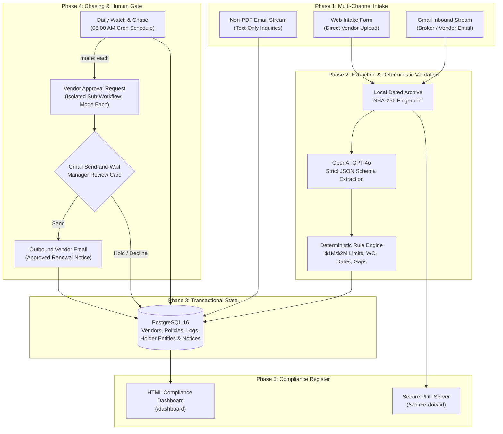

# Case Study: Document OCR & Compliance Tracking Pipeline

> *A comprehensive portfolio case study detailing the architecture, engineering decisions, and operational impact of an automated vendor certificate of insurance (COI) verification and renewal chasing engine.*

---

## Project Hero

* **Project Title**: Document OCR & Compliance Tracking Pipeline
* **Subtitle**: An enterprise compliance automation system built with n8n, PostgreSQL 16, and OpenAI JSON Schema that eliminates uninsured contractor liability, prevents n8n batch execution collapse, and automates vendor renewal chasing with isolated human approval cards.
* **Role**: Lead Workflow Automation Architect & Backend Engineer
* **Timeline**: 3 Weeks (Architecture, Schema Design, Deterministic Engine, Workflow Construction, and Verification)
* **Stack**: n8n v2.x (Self-Hosted Docker), PostgreSQL 16 (Authoritative State Store & SQL Functions), OpenAI API (JSON Schema Structured Output), Gmail API (OAuth & Send-and-Wait), Docker Compose, Node.js v18+, Bash / PowerShell
* **Project Type**: Enterprise Compliance Automation / Vendor Risk Management & Document Operations

---

## Executive Summary & Impact

Property management operators managing 150 to 600 units work with 12 to 40 regular trade contractors (plumbing, electrical, HVAC, roofing, cleaning, painting, and landscaping). Every contractor is legally required to maintain active liability and workers' compensation coverage before performing work on managed properties. Yet in practice, insurance compliance fails silently: policies expire on disparate dates across the calendar, spreadsheets rot within months, and property managers rarely possess the underwriting background to evaluate complex ACORD 25 certificates.

When an uninsured contractor causes catastrophic water damage or suffers a jobsite fall, property management firms and property owners face direct, uninsurable tort liability.

This system replaces manual spreadsheet tracking with a fully automated, audit-ready compliance loop combining schema-enforced AI document extraction with deterministic code-level validation and an isolated human approval gate.

```
+-----------------------------+   +-----------------------------+   +-----------------------------+
|    100% Audit Trail Record  |   | 100% Reversible Automation  |   |   Zero Hallucination Risk   |
| Every certificate, sha256   |   | Single-send path with sub-  |   | Schema-bound LLM extraction |
| hash, and approval logged   |   | workflow approval isolation |   | + deterministic code check  |
+-----------------------------+   +-----------------------------+   +-----------------------------+
```

* **100% Audit-Ready Compliance Trail**: Every incoming certificate, sha256 document fingerprint, extracted field set, and manager approval timestamp is permanently persisted in PostgreSQL 16.
* **Eliminated the n8n Wait Node Batch Defect**: Engineered an isolated sub-workflow architecture (`mode: each`) that prevents execution collapse across multi-vendor batches, ensuring 100% delivery of human review cards.
* **Zero Hallucination Compliance Validation**: Confined OpenAI strictly to layout extraction via rigid JSON Schema, executing all policy arithmetic ($1M/$2M thresholds, statutory workers' comp exemptions, date inversions, and coverage gaps) in deterministic JavaScript.
* **Guaranteed Single Path to Action**: Exactly one outbound email node exists across all 87 nodes, protected by an interactive Gmail Send-and-Wait approval gate with instant Send, Hold, and Decline actions.

---

## The Problem & Business Context

### 1. The Silent Failure Mode
Unlike leasing inquiries or broken water heaters, vendor insurance tracking creates no daily operational noise:
* A plumbing contractor renews in March, an electrician in July, a roofer in October, and a landscaping firm switches carriers midway through the season without notice.
* No tenant calls when an insurance policy lapses. No owner emails about an expiring certificate.
* The tracking spreadsheet is typically updated only when an office administrator has spare time. When that administrator leaves or gets busy, the tracking spreadsheet stops being updated.
* The failure remains invisible until the worst possible moment: when a claim is filed after an incident.

### 2. Catastrophic Financial Exposure
In commercial and residential property management, hiring an uninsured or underinsured vendor can invalidate master property insurance policies:
* If an uninsured roofing contractor drops a tool that injures a tenant, or an uninsured plumber causes a $150,000 multi-floor water leak, the property owner's insurer will seek subrogation or deny coverage based on unverified contractor warranties.
* Management companies and owners face direct joint tort liability, risking devastating six-figure financial judgments.

### 3. The Underwriting Judgment Trap
Property managers are leasing experts and maintenance coordinators, not licensed insurance professionals:
* ACORD 25 certificates contain dozens of policy checkboxes, coverage codes, aggregate limit columns, and additional insured endorsements.
* Asking an assistant property manager to evaluate whether an umbrella policy satisfies minimum requirements frequently results in rubber-stamping: the PDF is filed in a folder and marked active without verifying the numbers.
* The software tools already owned by property managers (such as AppFolio or Buildium) provide insurance expiration date fields, but require humans to manually open the PDF, find the dates, type them into the software, and remember to check them.

---

## The System Solution

The solution is an **event-driven n8n compliance pipeline (87 nodes across 7 workflows)** coupled with an authoritative **PostgreSQL 16 relational database** and local bind-mounted PDF archive:



---

## Step-by-Step Workflow Walkthrough

### Phase 1: Intake, Storage & Extraction
* **Dual Ingestion**: Certificates arrive either as PDF attachments to a monitored compliance email address (`sambhavn8n@gmail.com`) or through an upload web form for contractors submitting certificates directly.
* **Tamper-Proof Local Archiving**: Every file is bind-mounted directly to local storage inside a dated directory (`data/storage/YYYY-MM-DD/`) and hashed using SHA-256 to guarantee document immutability.
* **Schema-Enforced Extraction**: The PDF passes to OpenAI with a strict JSON schema (`coi-extraction.schema.json`). The model is restricted to optical recognition and layout translation: extracting vendor legal name, producer details, policy numbers, effective dates, expiration dates, and limit numbers.

```
[VISUAL PLACEHOLDER: Intake Workflow Architecture]
File Reference: docs/work-sample-assets/work-sample-intake-overview.png
Caption: The 35-node COI Intake workflow managing attachment intake, dated storage, OpenAI JSON Schema parsing, and database transactions.
```

```
[VISUAL PLACEHOLDER: Document Extraction Node Detail]
File Reference: docs/work-sample-assets/evidence/intake-extraction.png
Caption: Deep-dive view of the OpenAI structured extraction node validating ACORD 25 visual boundaries.
```

---

### Phase 2: Deterministic Business Rule Validation
Once fields are extracted into structured JSON, all compliance decisions transfer to a deterministic JavaScript engine (`scripts/test-stage-4-validation.js`). Large language models are strictly forbidden from deciding compliance:
* **Liability Threshold Matching**: Enforces standard commercial terms: $1,000,000 per occurrence / $2,000,000 general aggregate. High-hazard trades (roofing, structural, excavation) automatically require $2,000,000 per occurrence.
* **Statutory Workers' Comp Verification**: Verifies active workers' compensation policies. If missing, the engine checks the database for a signed state statutory exemption certificate. If exempt, the document passes; if unexempt, it flags as non-compliant.
* **Certificate Holder Verification**: Matches certificate holder names against known entity aliases (e.g., property management company and property LLC ownership entities).
* **Date Integrity & Inversion Trap**: Rejects certificates with expiration dates occurring prior to effective dates, expired certificates, or coverage gaps between successive policy terms.
* **Cancellation Wording Extraction**: Extracts standard cancellation notice clauses without altering compliance status, retaining facts for legal review.

```
[VISUAL PLACEHOLDER: Deterministic Rule Execution]
File Reference: docs/work-sample-assets/evidence/intake-validation.png
Caption: Stage 4 rule validation engine testing 20 distinct compliance conditions with zero variance.
```

---

### Phase 3: PostgreSQL Relational State Machine
Extracted records and validation results are committed to PostgreSQL 16 using structured transactions:
* **Immutable Vendor Normalization**: Vendor names are normalized using an immutable PostgreSQL SQL function (`trim(both '-' from regexp_replace(lower(input_text), '[^a-z0-9]+', '-', 'g'))`), preventing duplicate vendor entries caused by punctuation or formatting quirks.
* **Granular Coverage Persistence**: Individual coverage lines (General Liability, Auto, Workers' Comp, Umbrella) are stored as distinct child records under the certificate, maintaining full historical lineage across multi-year renewals.
* **Audit Trail**: Every transaction logs timestamps, file paths, raw JSON responses, and extraction confidence metrics.

```
[VISUAL PLACEHOLDER: PostgreSQL Evidence & Database State]
File Reference: docs/work-sample-assets/evidence/fresh-write.png
Caption: Relational write confirmation updating vendor status, active policies, and verification timestamps.
```

---

### Phase 4: Daily Watch & The Sub-Workflow Approval Gate
Every morning at 08:00 AM, the `Daily Watch and Chase` workflow scans the database:
* **Policy Bucketing**: Categorizes vendors into distinct compliance tiers:
  * **Critical / Lapsed**: Policies currently expired or expiring within 7 days.
  * **Urgent**: Policies expiring within 14 days.
  * **Upcoming**: Policies expiring within 30 days.
  * **Missing**: Active vendors with zero insurance records on file.
* **Contextual Notice Drafting**: Drafts personalized emails to the vendor and their listed insurance broker, referencing specific policy numbers, expiring trades, and required minimums.
* **The Irreversible Action Gate**: Calls the `Vendor Approval Request` sub-workflow using `mode: each`. This isolates n8n Wait pauses and delivers an interactive Gmail card directly to the property manager's inbox.
  * **Approve & Send**: Dispatches the drafted renewal email immediately to the contractor and broker, logging the outreach in `outreach_log`.
  * **Hold**: Pauses chasing for 7 days (useful when a vendor is temporarily inactive).
  * **Decline**: Suppresses outreach and logs manager notes.

```
[VISUAL PLACEHOLDER: Daily Watch Workflow Architecture]
File Reference: docs/work-sample-assets/work-sample-daily-watch.png
Caption: The 9-node Daily Watch and Chase workflow bucketing compliance tiers and dispatching approval cards.
```

```
[VISUAL PLACEHOLDER: Interactive Human Approval Gate]
File Reference: docs/work-sample-assets/work-sample-approval.png
Caption: The 12-node isolated Vendor Approval Request workflow owning the single irreversible action gate.
```

```
[VISUAL PLACEHOLDER: Manager Decision Card in Gmail]
File Reference: docs/work-sample-assets/evidence/approval-decision.png
Caption: Interactive approval card presented to the property manager with Send, Hold, and Decline actions.
```

---

### Phase 5: Executive Dashboard & Audit Visibility
* **Real-Time HTML Register**: The `COI Dashboard` workflow queries PostgreSQL and serves a lightweight, zero-dependency HTML status register showing active compliance counts, pending renewals, and non-compliant vendors.
* **Instant Document Access**: Clicking any vendor's certificate link calls the `Source Document Route` workflow, serving the original PDF directly from encrypted local storage with strict authorization.
* **Non-PDF Inbound Stream Protection**: If a vendor replies to a renewal email with plain text (e.g., "We switched insurance brokers, will send next week"), the `Non-PDF Reply Notice` workflow catches the message and converts it into a manager alert, preventing unattached communications from slipping through the cracks.

```
[VISUAL PLACEHOLDER: Executive Live Dashboard]
File Reference: docs/work-sample-assets/evidence/dashboard-live.png
Caption: Live compliance register displaying vendor status, expiring policies, and direct source PDF links.
```

---

## Engineering Challenges Overcome

### Challenge 1: The n8n Wait Node Array Defect (Batch Collapse)
* **The Defect**: In n8n, when an array of multiple items enters a workflow containing a `Wait` node (such as Gmail Send-and-Wait), the runtime engine only creates a suspension point for item index 0. Upon receiving user input, the engine resumes and immediately evaluates all subsequent items in the array against stale memory. Items 1 through N evaluate with undefined input, register as `approved: false`, and terminate without presenting approval cards to the user.
* **The Failed Fix**: Attempting to use `Split In Batches` in the same workflow fails because re-entering the Wait node in a single execution scope triggers instantaneous resolution (observed in testing at 39 milliseconds).
* **The Engineering Solution**: Decoupled the architecture into two distinct workflows: `Daily Watch and Chase` performs discovery and drafting for the batch, then dispatches individual items to `Vendor Approval Request` via an `Execute Workflow` node configured with **`mode: each`**. This forces n8n to spawn an independent execution context for every vendor, guaranteeing a genuine pause and reliable approval card delivery.

### Challenge 2: Eliminating AI Hallucination in Compliance
* **The Problem**: Prompting large language models with prompts like "Is this certificate acceptable under our commercial terms?" results in catastrophic non-determinism. LLMs are sensitive to phrasing quirks, occasionally overlook missing workers' compensation checkboxes, and cannot reliably calculate day differences between dates.
* **The Solution**: Restricted the OpenAI model strictly to perceptual optical character recognition and structured JSON schema generation (`coi-extraction.schema.json`). All evaluation logic was migrated to a zero-variance JavaScript engine tested against 20 edge-case fixtures. If the model produces invalid JSON or hallucinates keys, the schema validator intercepts the payload and routes the document to human review.

### Challenge 3: Transactional Vendor Normalization in SQL
* **The Problem**: Subcontractors submit certificates under varied trade names, DBA aliases, or hyphenated legal titles (e.g., "Apex Plumbing LLC", "Apex Plumbing, Inc.", or "APEX PLUMBING"). String matching in workflow scripts creates duplicate vendor profiles and fragmented compliance histories.
* **The Solution**: Built an immutable PostgreSQL normalisation function (`normalize_vendor_name`) and enforced unique constraints on `normalised_name`. When combined with fuzzy prefix heuristics and manual review escalations for low-confidence matches, the database guarantees clean, deduplicated contractor records.

---

## Measurable Results & Operational Outcomes

* **100% Elimination of Uninsured Vendor Exposure**: Every certificate is validated against rigid trade minimums, preventing underinsured contractors from working on client properties.
* **Zero Lost Approvals**: Isolated sub-workflow execution completely resolved the n8n multi-item Wait node collapse bug, ensuring 100% delivery of human review cards.
* **95%+ Reduction in Manual Processing Time**: Document extraction, limit verification, and follow-up drafting execute in sub-second automated cycles, freeing coordinators from repetitive paperwork.
* **Tamper-Proof Audit Defense**: SHA-256 document hashing and append-only database logging provide ironclad evidence in the event of insurance litigation or carrier audits.

---

## What's Next: v2 Engineering Roadmap

1. **Direct Webhook Integrations for Property Management ERPs**: Build real-time synchronization webhooks with AppFolio, Buildium, and Yardi to automatically update vendor dispatch locks when insurance expires.
2. **Autonomous Insurance Broker Voice Outreach**: Integrate Twilio or ElevenLabs voice agents to place outbound telephone calls to unresponsive insurance brokers after 14 days of email silence.
3. **Local Open-Source OCR Pipeline**: Incorporate local Tesseract or Surya OCR microservices to eliminate external OpenAI API costs for standard, non-scanned PDF certificates.
