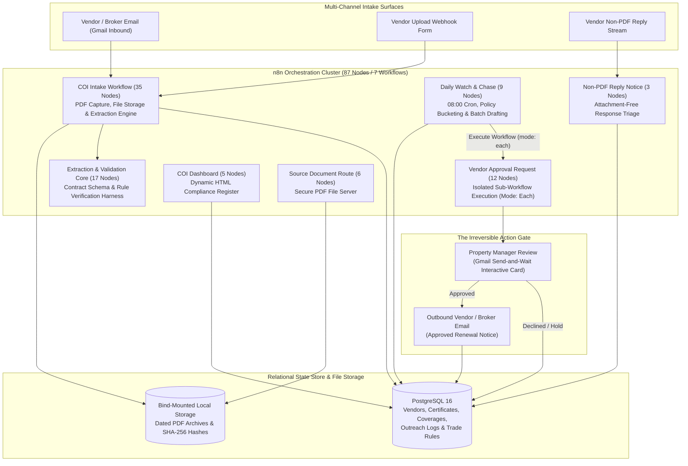

# Document OCR & Compliance Tracking Pipeline

[](https://n8n.io)
[](https://www.postgresql.org)
[](https://openai.com)
[](https://www.docker.com)
[](#the-single-path-to-the-irreversible-action)
[](scripts/test-stage-4-validation.js)

> **An event-driven compliance automation engine that ingests vendor certificates of insurance (COIs) via Gmail and web forms, extracts structured policy limits via schema-bound LLM parsing, executes deterministic compliance validation, and orchestrates renewal chasing through an isolated human approval gate.**

---

## The Operational Problem

Property management firms operating between 150 and 600 doors work with 12 to 40 regular trade contractors (plumbers, electricians, HVAC mechanics, roofers, landscapers, cleaners, and painters). Every vendor must maintain active liability coverage before dispatch to client properties:

* **The Silent Failure Mode**: Policies expire on arbitrary dates across the calendar year. A plumber renews in March, a roofer in August, while a painter switches carriers without notifying management. Spreadsheets rot within months because tracking renewal dates is nobody's full-time job.
* **Catastrophic Risk Exposure**: If an uninsured or lapsed contractor causes a water leak, electrical fire, or falls on site, the commercial property policy can deny the claim. The property manager and property owner become directly exposed to substantial tort liability.
* **The Manual Chasing Grind**: Chasing 30 vendors requires emailing the contractor, waiting, contacting their insurance broker, receiving a PDF certificate, checking four date fields, verifying $1M/$2M limits, and logging the record. This takes 4 to 6 minutes per document plus repeated follow-ups for non-responsive vendors.
* **The Judgment Trap**: Property managers are not licensed insurance underwriters. When presented with ambiguous ACORD 25 certificates, staff members often file the document without verifying policy limits, additional insured endorsements, or coverage gaps.

### The System Solution

This engine replaces manual spreadsheet tracking with a self-contained, audit-ready compliance loop:
1. **Intakes Certificates via Gmail & Web Forms**: Monitors dedicated compliance inboxes and intake webhooks for incoming ACORD 25 PDF documents.
2. **Schema-Enforced Extraction**: Uses OpenAI with strict JSON Schema structured output to extract insured entity names, policy numbers, dates, and liability limits without hallucinations.
3. **Deterministic Business Rule Validation**: Applies zero-tolerance validation in pure JavaScript (trade-specific coverage thresholds, workers' comp exemptions, additional insured matching, date inversion detection, and retroactive coverage gap logging).
4. **Isolated Human Approval Gate**: Evaluates renewal calendars daily at 08:00 AM, drafts personalized renewal notices, and presents interactive approval requests (Send, Hold, Decline) to property managers.
5. **Real-Time Compliance Register**: Renders an executive compliance dashboard and serves encrypted original source PDFs directly from local storage.

---

## System Architecture



---

## Workflow Inventory

The production engine contains **87 nodes across 7 structured workflows**:

| Workflow | Nodes | Trigger | Primary Responsibility |
| :--- | :---: | :--- | :--- |
| **`COI Intake`** | 35 | Gmail Trigger / Form Webhook | Normalizes filenames, saves PDF to dated local storage, runs LLM structured extraction, validates business rules, and updates PostgreSQL. |
| **`Vendor Approval Request`** | 12 | Sub-Workflow Execution (`mode: each`) | Owns the single irreversible action gate: pauses per-vendor execution via Gmail Send-and-Wait, logs human decisions, and delivers outbound emails. |
| **`Daily Watch and Chase`** | 9 | Schedule Cron (08:00 AM) | Scans database for missing, expired, and upcoming expirations (30, 14, 7 days), drafts renewal notices, and invokes the approval sub-workflow. |
| **`Extraction and Validation Core`** | 17 | Direct Sub-Workflow Call | Deterministic rule verification harness implementing schema matching, date checks, limit comparisons, and audit flags. |
| **`Source Document Route`** | 6 | Webhook (`GET /source-doc/:id`) | Delivers original stored certificate PDFs securely to the manager dashboard. |
| **`COI Dashboard`** | 5 | Webhook (`GET /dashboard`) | Compiles database records into a responsive HTML compliance register with zero external front-end dependencies. |
| **`Non-PDF Reply Notice`** | 3 | Gmail Reply Trigger | Captures incoming emails from vendors that do not include PDF attachments, notifying managers instead of silently failing. |

---

## Architectural Highlights & Engineering Decisions

### 1. The n8n Wait Node Array Defect & Sub-Workflow Isolation
A critical architectural challenge in n8n involves handling human approvals across multiple items. When an array of multiple vendors is passed into a single execution containing a `Wait` node (e.g., Gmail Send-and-Wait):
* The Wait node pauses for the **first item only**.
* Upon resuming, the engine resolves the entire array simultaneously. Items 2 through N receive empty approval data, evaluate as `approved: false`, and are recorded as declined without sending an approval card.
* Looping with `Split In Batches` does not resolve this constraint, as subsequent iterations hit stale execution memory and complete in milliseconds.

**The Solution**: `Daily Watch and Chase` executes batch discovery, drafting, and pending record creation in one pass, then calls `Vendor Approval Request` via an `Execute Workflow` node set strictly to **`mode: each`**. Each actionable vendor runs in an isolated execution with its own genuine pause state, guaranteeing zero lost approval cards.

### 2. LLM Extraction vs. Deterministic Validation
A common architectural flaw in AI automations is delegating compliance decisions to large language models. LLMs excel at parsing visual layouts and unstructured text, but fail at rigid arithmetic and deterministic logic:
* **LLM Role (Perception Only)**: OpenAI parses the ACORD 25 PDF into a strict, validated **JSON Schema** (`coi-extraction.schema.json`). If the model output violates the schema, the engine halts and routes the file to human review.
* **Deterministic Code Role (Judgment Only)**: All business logic runs in pure JavaScript:
  * Minimum limit checks: $1,000,000 per occurrence / $2,000,000 general aggregate.
  * Trade-specific limit rules: Demanding $2,000,000 occurrence limits for high-hazard trades (roofing, structural).
  * Workers' compensation verification: Soft-flagging missing coverage unless the vendor possesses an active state statutory exemption.
  * Date integrity checks: Flagging inverted dates (expiration prior to effective date), expired submissions, and coverage gaps between policy terms.

### 3. The Single Path to the Irreversible Action
In an automated compliance system, sending an unauthorized email to a subcontractor or client insurance broker is an irreversible error.
* Across all 7 workflows, exactly **one node** possesses outbound sending capability: the `Send Email to Vendor` node inside `Vendor Approval Request`.
* This node is structurally unreachable without traversing the interactive Gmail Send-and-Wait human verification gate.
* If a manager selects **Hold** or **Decline**, the engine logs the decision in PostgreSQL and terminates execution without sending a message.

---

## Database Architecture

State is managed authoritatively by **PostgreSQL 16** with strict relational integrity, immutable normalization triggers, and comprehensive audit trails:

```sql
-- Normalized name generator ensuring robust vendor matching
CREATE OR REPLACE FUNCTION normalize_vendor_name(input_text TEXT)
RETURNS TEXT LANGUAGE sql IMMUTABLE AS $$
  SELECT trim(both '-' from regexp_replace(lower(input_text), '[^a-z0-9]+', '-', 'g'));
$$;
```

### Core Schema Components:
* **`vendors`**: Primary vendor records, trade category, statutory workers' compensation exemption status, chase pause switches, contact email, and insurance broker contact info.
* **`certificates`**: Certificate metadata, raw extraction JSON, sha256 document fingerprint, disk file path, and extraction confidence score.
* **`coverages`**: Individual policy records (General Liability, Workers' Comp, Auto, Umbrella), effective dates, expiration dates, occurrence limits, and aggregate limits.
* **`outreach_log`**: Append-only audit log recording every drafted notice, human approval decision, timestamp, message payload, and outbound delivery status.
* **`trade_requirements`**: Configurable coverage thresholds indexed by trade classification.
* **`intake_notices`**: Queue of non-PDF or anomalous inbound communications requiring administrative inspection.

---

## Local Setup & Quickstart

### Prerequisites
* Docker & Docker Compose
* Node.js v18 or higher (for unit tests and validation)

### 1. Initialize Configuration
Clone the repository and generate your local environment configuration:
```bash
git clone https://github.com/SambhavJain26/vendor-coi-chasing.git
cd vendor-coi-chasing
cp .env.example .env
```

### 2. Launch Local Infrastructure
Start PostgreSQL, n8n, and pgweb database viewer:
```bash
docker compose up -d
```
Services will become available at:
* **n8n Workflow Editor**: `http://localhost:5678`
* **pgweb Database Viewer**: `http://localhost:8081`
* **PostgreSQL Database**: `localhost:5432`

### 3. Run Automated Validation Suite
Execute the 20-point deterministic compliance verification suite:
```bash
node scripts/test-stage-4-validation.js
```
Expected output:
```text
ok - happy path stores ON_FILE
ok - model output parser handles object and string outputs
ok - model refusal becomes hard flag
ok - invalid model output becomes hard flag
ok - password PDF error is graceful
ok - not a COI is ignored
ok - date inversion forces review
ok - invalid and implausible dates force review
ok - low confidence forces review
ok - missing GL is a soft flag
ok - missing WC is soft unless vendor is exempt
ok - holder mismatch is soft
ok - accepted owner LLC holder passes
ok - trade-specific low limits are soft
ok - older than on file is ignored
ok - coverage gap stores gap day count
ok - near duplicate vendor forces review
ok - high-risk missing cancellation wording is a note
ok - cancellation wording is retained as neutral fact
ok - cancellation wording strips fixture label prefix
Stage 4 validation tests complete.
```

---

## Technical Retrospective & Trade-offs

| Engineering Choice | Chosen Architecture | Alternative Considered | Technical Rationale |
| :--- | :--- | :--- | :--- |
| **Automation Engine** | Self-hosted n8n via Docker | Hosted Zapier / Make | Prevents client document archives and corporate email access from residing in third-party multi-tenant SaaS accounts. Ensures zero vendor lock-in. |
| **Transactional State** | PostgreSQL 16 Relational Store | n8n Internal Data Tables | Preserves portable database dumps that clients own independently of the workflow runtime; allows advanced SQL functions and normalization triggers. |
| **Document OCR** | OpenAI API via JSON Schema | Dedicated OCR SaaS (Textract) | ACORD 25 certificates are standard structured forms with embedded PDF text layers in 85%+ of cases. Model parsing handles both scanned and digital forms without secondary vendor fees. |
| **Decision Authority** | Pure JavaScript Rules Engine | Natural Language LLM Evaluation | Compliance verification requires zero variance. Deterministic code guarantees identical outputs for identical inputs, eliminating prompt regression. |
| **Approval Execution** | Isolated sub-workflow (`mode: each`) | Single workflow batch loop | Completely eliminates n8n's array Wait-node collapse bug, guaranteeing a distinct human review card for every actionable vendor. |

---

## License

Internal proprietary automation asset. All rights reserved. Developed for production property management operations.
